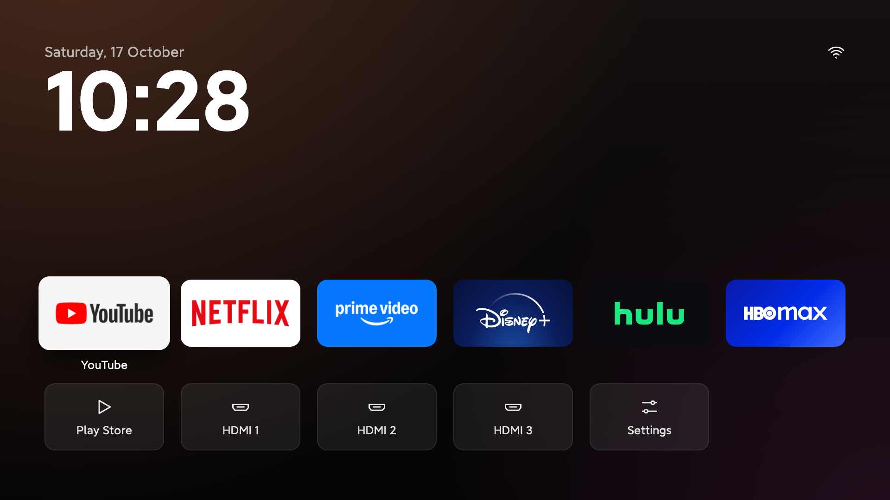

<div align="center">

# HomeScreen v4.2.0

### Universal Multi-Universe Animated Home Launcher for Android TV, Google TV, Foldables, Phones & Tablets

[-FFD54F?style=for-the-badge)](releases/HomeScreen_Release_v4.2.0_42.apk)
[](releases/HomeScreen-Universal-TV-Foldable-Tablet-Release-v4.2.0-b42.apk)
[](LICENSE)

**Download Ready-to-Install Release APKs (`406 KB`):**
[**⬇ Download `HomeScreen_Release_v4.2.0_42.apk`**](releases/HomeScreen_Release_v4.2.0_42.apk) · [**⬇ Download `HomeScreen-Universal-TV-Foldable-Tablet-Release-v4.2.0-b42.apk`**](releases/HomeScreen-Universal-TV-Foldable-Tablet-Release-v4.2.0-b42.apk)



</div>

---

## ✨ What is HomeScreen?

**HomeScreen** (built on the ultra-lightweight [TV Detox](https://github.com/Ansub/tv-detox) foundation) is a zero-bloat, 60 FPS procedural-canvas home screen launcher for **Android TV**, **Google TV**, **Foldables**, and **Tablets** (`395 KB` total APK size, zero external libraries, zero ads).

### 🌌 6 Interactive Universe Themes (`248` Total Animated Story Scenes)
Switch themes anytime from the top-right **3-Card Theme Swatch** icon or **Settings → Universe Theme**. Each theme transforms the entire home screen—sky architecture, floating particles, custom franchise typography, app card crests, and a `1.5x` bottom **Saga Theater** running at `0.5x` cinematic speed:

1. **⚡ Harry Potter (Wizarding World) — `68` Chronological Scenes (`I`–`LXVIII`)**
   - Great Hall enchanted ceiling with twinkling stars, floating candles, Hogwarts House ghosts, Marauder's Map footsteps, and a Golden Snitch companion that tracks your focused app tile.
   - 68 iconic scenes spanning all 8 films: *Privet Drive Deluminator*, *Hogwarts Express*, *Sorting Hat*, *Quidditch Golden Snitch*, *Chamber of Secrets Basilisk*, *Expecto Patronum Stag*, *Hungarian Horntail*, *Graveyard Priori Incantatem*, *Dumbledore vs. Voldemort*, *Gringotts Ukrainian Ironbelly*, *Battle of Hogwarts*, and *Nineteen Years Later*.
2. **🍥 Naruto Shippuden — `36` Chronological Scenes (`I`–`XXXVI`)**
   - Hidden Leaf Hokage Monument, crimson Akatsuki clouds, drifting autumn leaves, and bespoke show-accurate renderers for **Naruto Uzumaki** (spiky blonde hair, whiskers, orange jumpsuit, Six Paths cloak), **Sasuke Uchiha** (ducktail hair, 3-Tomoe Sharingan, Kusanagi sword, multi-branched Chidori lightning), **Itachi Uchiha**, **Kakashi**, **Minato**, **Jiraiya**, **Madara Twin Meteors**, and **Might Guy Eighth Gate Night Guy Dragon**.
3. **🗡️ Demon Slayer (Kimetsu no Yaiba) — `36` Chronological Scenes (`I`–`XXXVI`)**
   - Mount Fujikasane glowing violet Wisteria trees, Infinity Castle shoji pillars, and bespoke renderers for **Tanjiro Kamado** (green-and-black checkered Haori, wooden Nezuko box, Hanafuda earrings, Water Breathing & Hinokami Kagura Sun Dragon), **Nezuko Kamado** (bamboo muzzle, pink kimono, Blood Demon Art flames), **Zenitsu Agatsuma** (multi-branched jagged golden-blue *Thunderclap and Flash* & *Flaming Thunder God*), and **Kyojuro Rengoku** (*Set Your Heart Ablaze* vs. Akaza).
4. **⚔️ Star Wars — `36` Chronological Scenes (`I`–`XXXVI`)**
   - Tatooine binary suns, Imperial Star Destroyers, Death Star II superlaser dish, and bespoke renderers for **Darth Vader** (flared dome helmet, illuminated chest control box, crimson lightsaber), **Luke Skywalker & Obi-Wan Kenobi**, **Darth Maul** (Zabrak horns & double-bladed saber), **Master Yoda** (Dagobah X-Wing Force lift), **Ahsoka Tano**, and **The Mandalorian & Grogu**.
5. **🛡️ Marvel Cinematic Universe (MCU) — `36` Chronological Scenes (`I`–`XXXVI`)**
   - Avengers Tower skyline, Sanctum Sanctorum window, Cosmic Infinity Nebula, and bespoke renderers for **Iron Man Mark LXXXV** (hot-rod red & gold armor, glowing cyan Arc Reactor, Repulsor beams), **Captain America** (Vibranium star shield & Mjolnir), **Thor Odinson** (Bifrost sky-to-ground forked thunderbolts & Stormbreaker), **Doctor Strange** (Eldritch Tao mandalas), **Spider-Man**, **Black Panther**, and **Thanos** (Infinity Gauntlet).
6. **🦇 DC Universe (DCU) — `36` Chronological Scenes (`I`–`XXXVI`)**
   - Gotham gothic gargoyles, glowing Bat-Signal in the clouds, Metropolis Daily Planet globe, and bespoke renderers for **Batman (The Dark Knight)** (pointed Bat-cowl, scalloped cape, golden chest Bat-emblem, Tumbler Batmobile), **Superman (Man of Steel)** (sonic boom flight & jagged Heat Vision beam), **Wonder Woman** (Golden Lasso of Truth), **The Flash** (multi-branched Speed Force lightning & afterimages), **Aquaman**, **Green Lantern**, and **Darkseid** (zig-zagging Omega Beams).

---

## 💡 Live FancyLEDs Ambilight UDP Sync & 4-Edge Screen Glow
- Listens on UDP port `6667` / `6666` for local Tuya / **FancyLEDs Sync Box** broadcasts and renders a 4-edge reactive Ambilight border that smoothly crossfades to match the focused app or HDMI input.
- Toggle the 4-edge glow anytime via the **Glow On/Off** icon in the top-right dock.

---

## 📲 Install on Android TV, Google TV, Foldables, or Tablets

### Option A: Direct APK Install (Phone / Tablet / Foldable / TV Browser or File Manager)
Download [**`HomeScreen_Release_v4.0.0_40.apk`**](releases/HomeScreen_Release_v4.0.0_40.apk) directly onto your device and open it to install.

### Option B: Install over Wi-Fi via `adb`
```sh
adb connect <YOUR_DEVICE_IP>:5555
adb install -r releases/HomeScreen_Release_v4.0.0_40.apk
adb shell cmd package set-home-activity com.ansub.tvhome/.MainActivity
adb shell am start -n com.ansub.tvhome/.MainActivity
```

### Option C: Build from Source (`build.sh`)
Requires Java 17 and Android SDK (`platforms;android-34` and `build-tools;34.0.0`):
```sh
./build.sh
```
Produces 4-byte `zipalign`ed, v1/v2/v3 signed release APKs in `out/`:
- `out/HomeScreen_Release_v4.0.0_40.apk`
- `out/HomeScreen-Universal-TV-Foldable-Tablet-Release-v4.0.0-b40.apk`
- `out/HomeScreen.apk`

---

## 🎮 Controls (TV Remote, Keyboard, Touch & Stylus)
- **D-Pad / Arrow Keys / Touch Tap**: Navigate and launch apps, HDMI inputs, Wi-Fi, Bluetooth, Sound, Picture, Glow Toggle, and Universe Theme Picker.
- **Swipe Up on Home Screen (Foldables / Phones / Tablets)**: Open the searchable **All Apps Drawer** for all installed apps.
- **Swipe Down on Home Screen (Foldables / Phones / Tablets)**: Expand the Android **Notification Center & Quick Settings Shade**.
- **Long-Press OK (or Long-Press Touch) on an App Tile**: Move, Replace, Remove from Home, App Info, or Uninstall.
- **Touch / Swipe on Bottom Story Stage (Tablets & Foldables)**: Tap the right half (or swipe left) for **Next Story Scene**; tap the left half (or swipe right) for **Previous Story Scene**.
- **Settings → Next Story Scene**: Manually step through scenes on any remote.

---

## 📄 Credits & License
- Original **TV Detox** foundation by [Ansub Khan](https://github.com/Ansub/tv-detox).
- **HomeOS v2.4.0** Multi-Universe Saga Theater, Bespoke Character Engine, FancyLEDs Ambilight Sync, and Universal TV/Foldable/Tablet Adaptive Architecture by **Revanth Mukka** ([@revumukka](https://github.com/revumukka)).
- Released under the [MIT License](LICENSE).
